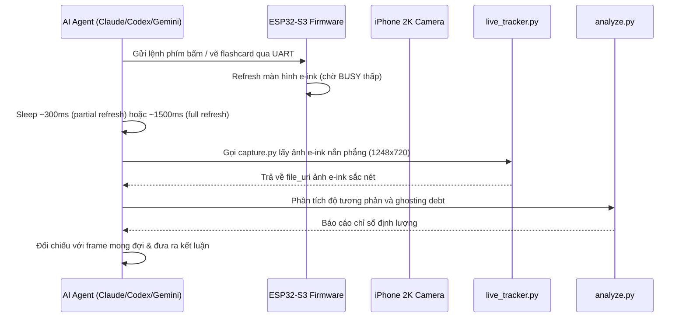

# InkFlash Vision Test (AI Real-time Camera Feedback System)

Hệ thống chụp và kiểm thử thị giác thời gian thực cho màn hình e-ink InkFlash (ESP32-S3 + WeAct 3.7" UC8253), phục vụ các AI agent (Claude, Codex, Gemini, Antigravity) và nhà phát triển.

---

## 1. Thiết lập phần cứng & Camera (iPhone qua cáp Lightning)

### 1.1. Cài đặt phần mềm kết nối
1. **Trên iPhone**:
   - Cài app **Iriun 4K Webcam** từ App Store (miễn phí).
2. **Trên Máy tính (Windows)**:
   - Tải và cài đặt **Iriun Webcam for Windows** từ [iriun.com](https://iriun.com).
   - Mở cửa sổ Iriun Webcam trên Windows, tại mục **Format** chọn: **`2560x1440`** (chuẩn 2K QHD) hoặc **`3840x2160`** (4K).
3. **Kết nối USB bắt buộc**:
   - Tắt tạm Wi-Fi trên iPhone để ép luồng truyền tải 100% qua cáp Lightning (tránh bị nén vỡ hạt do mạng Wi-Fi).
   - Cắm cáp Lightning, mở khóa iPhone và chọn **Tin cậy máy tính này (Trust)**.
   - Kiểm tra dòng chữ trên cùng trong app Iriun trên iPhone: hiển thị **`Connected via USB`**.

### 1.2. Đặt vị trí máy và lấy nét e-ink
- **Bóc lớp seal nilon**: Bóc miếng dán bảo vệ trong suốt ở góc màn hình e-ink (nơi có tai nilon kéo ở góc dưới bên phải) để mặt kính trong suốt, triệt tiêu sương mờ.
- **Khoảng cách đặt iPhone**: Đặt iPhone cách màn hình khoảng **20 – 25 cm** (tránh để quá gần dưới 15 cm vì thấu kính chính của iPhone sẽ bị out nét quang học).
- **Tránh phản chiếu gương**: Đặt iPhone nghiêng nhẹ 75° – 80° hoặc che bớt đèn trần chiếu trực diện vào kính e-ink.
- **Khóa nét & sáng**: Chạm giữ vào vùng chữ/màn hình trên app Iriun của iPhone cho đến khi hiện chữ vàng **`AE/AF LOCK`**.

---

## 2. Khởi động Real-time Tracker & Web UI

Chạy tracker để tự động bám dính màn hình e-ink và nắn phẳng theo thời gian thực:

```powershell
python tools/vision_test/live_tracker.py
```

Truy cập giao diện Web: **`http://localhost:5000`**

### Các tính năng trên giao diện:
- **Khung bên trái**: Luồng video camera trực tiếp (2K QHD) với 4 chấm màu và khung xanh lá tự động bám theo 4 góc màn hình e-ink (Lucas-Kanade Optical Flow + Homography RANSAC).
- **Khung bên phải**: Màn hình e-ink đã được nắn thẳng tắp theo chuẩn **`1248 × 720`** (3x supersampling của panel 416 × 240) có kèm bộ lọc tăng nét cạnh vi mô (Unsharp Mask).
- **Can thiệp thủ công (Kéo thả 4 góc)**: Dùng chuột kéo thả trực tiếp 4 chấm màu (**TL: Đỏ, TR: Xanh dương, BR: Xanh lá, BL: Cam**) trên màn hình video để nắn lại mép viền e-ink nếu AI track lệch.
- **Nút "Tắt Auto-Track (Khóa cứng)"**: Cố định 100% tọa độ 4 góc, ngăn thuật toán tự động dịch chuyển khi camera đứng yên.
- **Nút "Click lại 4 điểm"**: Chọn lại 4 góc màn hình từ đầu bằng 4 cú click chuột.
- **Thước đo nét (Sharpness Meter)**: Báo độ nét tiêu cự thời gian thực (`RẤT NÉT`, `TẠM ỔN`, hoặc `MỜ - CẦN KHÓA AF`).

---

## 3. Cách AI Agent sử dụng (CLI Standard)

Script nằm tại `tools/vision_test/capture.py`.

### 3.1. Chụp ảnh kiểm thử (Tự động nắn phẳng & Tự tạo thư mục)
AI có thể tự do tạo cấu trúc thư mục lồng nhau trong `tools/vision_test/captures/`:

```powershell
# Chụp ảnh vào thư mục con tùy ý (trả về kết quả JSON)
python tools/vision_test/capture.py -o test_runs/card_01/front.jpg --json
```

*Lưu ý: Nếu `live_tracker.py` đang chạy, lệnh trên sẽ lấy ngay ảnh nắn phẳng thời gian thực từ `http://localhost:5000/snapshot` trong **dưới 0.05 giây**.*

Output JSON tiêu chuẩn cho AI:
```json
{
  "status": "success",
  "file": "C:/Users/.../tools/vision_test/captures/test_runs/card_01/front.jpg",
  "relative_path": "tools/vision_test/captures/test_runs/card_01/front.jpg",
  "file_uri": "file:///C:/Users/.../tools/vision_test/captures/test_runs/card_01/front.jpg",
  "device": "Iriun Webcam",
  "width": 1248,
  "height": 720,
  "size_bytes": 61339,
  "timestamp": "2026-11-16T00:15:00.123456"
}
```

### 3.2. Chụp khung camera toàn cảnh (Raw Feed)
```powershell
python tools/vision_test/capture.py --raw -o raw_screen.jpg --json
```

---

## 4. Công cụ Phân tích Quang học Định lượng (`analyze.py`)

Đo lường độ nét, độ tương phản và hiện tượng lưu ảnh (ghosting / debt):

```powershell
python tools/vision_test/analyze.py -i tools/vision_test/captures/test_runs/card_01/front.jpg --json
```

Kết quả phân tích JSON:
```json
{
  "status": "ok",
  "resolution": "1248x720",
  "sharpness_score": 184.2,
  "focus_status": "SHARP",
  "contrast_ratio": 9.4,
  "black_level": 18.2,
  "white_level": 171.0,
  "uniformity_score": 0.942,
  "ghosting_debt_percent": 1.25,
  "verdict": "PASS",
  "recommendation": "Display quality is optimal for testing."
}
```

---

## 5. Quy trình Kiểm thử Tự động cho AI (Visual Feedback Loop)


